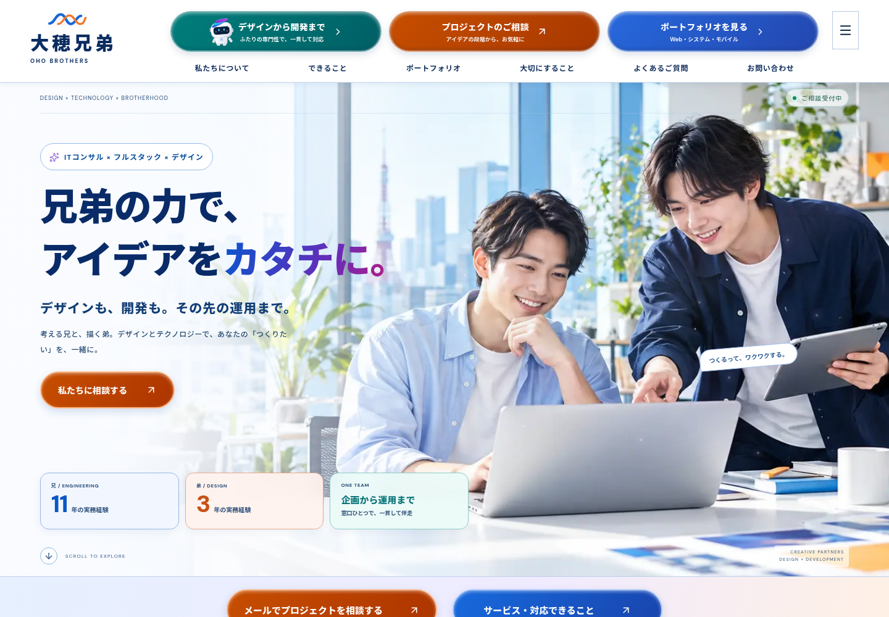
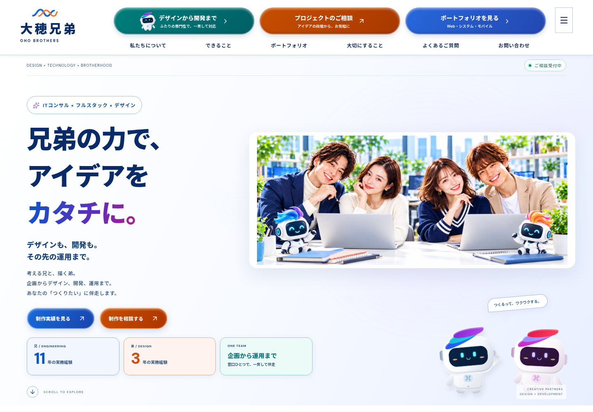
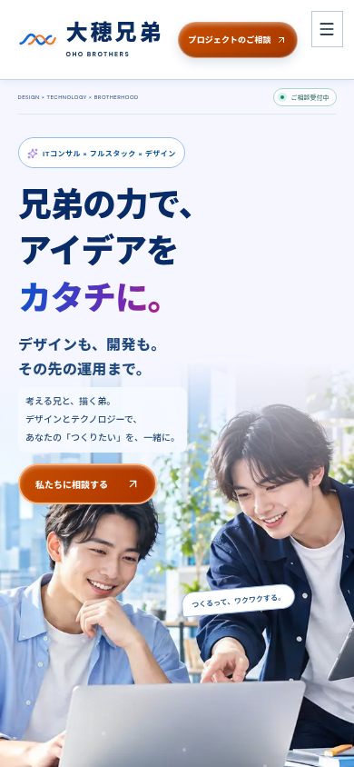
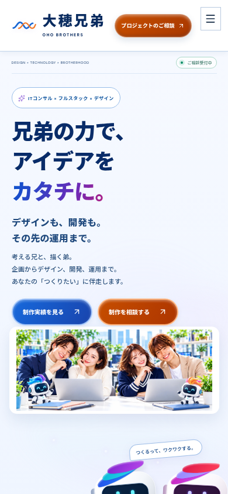
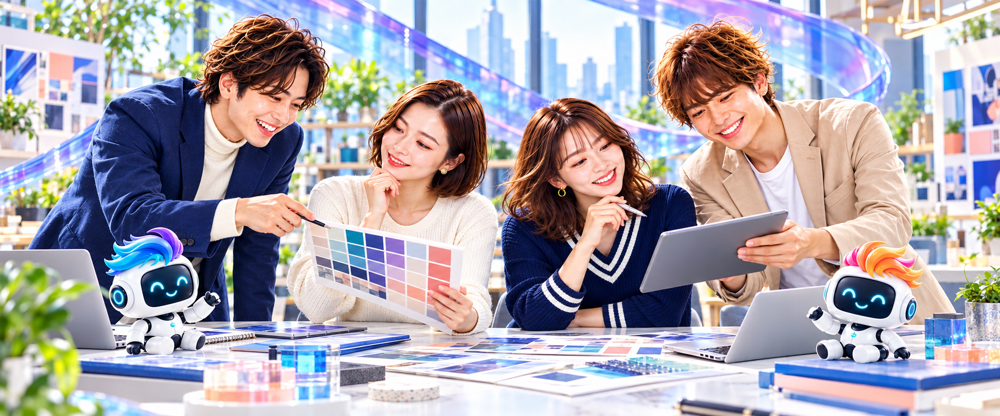
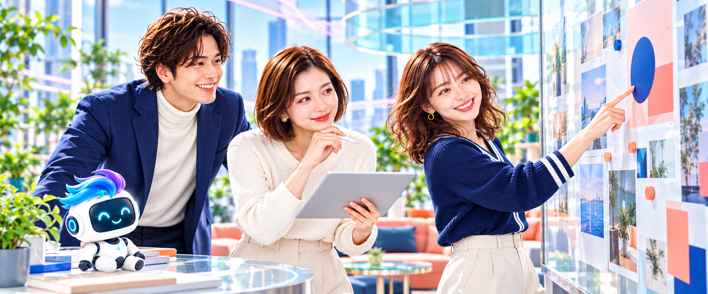

# 大穂兄弟 / BROTHERS

「兄弟の力で、アイデアをカタチに。」をテーマにした、日本語のポートフォリオサイトです。

## 技術スタック

- Next.js 16.4.3 / App Router
- React 19.3.1 / TypeScript
- Three.js 0.186.1（WebGLシェーダーによるスクロール切り替え）
- GSAP 3.15 / ScrollTrigger（ヒーロー・スクロール演出・マーキー・カード・ボタン）
- CSSアニメーション / Lucideアイコン
- Outfit Variable / Noto Sans JP Variable（ローカル配信。Google Fontsへの接続不要）
- Playwright（PC / モバイルの操作テスト）

Node.js 20.9以上が必要です。この環境ではNode.js 24で検証しました。

## 起動

```bash
cd /workspace/chan_portfolio_repository
npm ci
npm run dev
```

開発サーバーはポート3000を使用します。本番相当の確認は次の通りです。

```bash
npm run build
npm run start
```

## 実装内容

- プロフィール、対応業務、Lancers掲載ポートフォリオ、制作方針、FAQ、お問い合わせ
- 提供された参照画像の4人をもとにした集合ビジュアル。4人全員が見えるヒーローと紹介欄、微細な2.5Dモーション
- Three.jsの実際の3Dロボット2体：丸みのあるメタル筐体・黒いフェイスディスプレイ・LEDの目・関節・多色の髪。まばたき・呼吸・手振り・視線追従はGSAPでアニメーション
- ヒーローを固定し、GSAP ScrollTriggerでズーム・カメラ風の移動・ぼかし・メッセージ切り替え
- Three.jsのスペクトル光、オーロラ状のリボン、浮遊する光の粒
- ボタン外周の枠線アニメーション、ホバー時の吹き出しラベル
- スキルの無限マーキー（ホバー時に停止）
- カーソル追従、ヒーローのパララックス
- 15件のカテゴリ別ポートフォリオ、GSAPによる3Dチルト・拡大・ホバーラベル
- 掲載ポートフォリオの詳細ダイアログとFAQアコーディオン
- 相談メモの作成、クリップボードへのコピー、内容を引き継いだメール作成
- モバイルメニュー、キーボード操作、フォーカス制御、動きを抑える設定への対応
- WebGL非対応時も画像・本文を表示

ポートフォリオ15件は、ご提供いただいたLancersのスクリーンショットに写る説明から転記しています。案件別のURL・技術構成・費用・成果数値など、写っていない情報は追加していません。プロフィール内容も提供された情報をもとに構成しています。

## お問い合わせ

屋号は「大穂兄弟」です。

- Discord：`shiner715`（ユーザー名。数値のユーザーIDではないためDiscordを開き、フレンド追加から検索します）
- Chatwork：`3htt4mii70cg8`
- Email：`cbnbc07@gmail.com`

連絡先情報とフォームを2列で配置し、IDのコピー、各サービスを開く操作、相談内容のコピーを用意しています。`https://akame-portfolio-showcase.vercel.app/` の公開されたコンタクト構成（連絡先情報 + フォーム）を参考に、全体と同じパレットへ合わせました。

フォームはメールアプリで下書きを作成する方式です。サイトからの直接送信や送信済みの表示は行いません。入力内容はサーバーやローカルストレージへ保存しません。

「プロジェクトを相談する」はメールアプリを開きます。「相談内容をまとめてから送る」では相談内容を入力し、メールアプリへ引き継いだりコピーしたりできます。サイトからメールを直接送信する機能はありません。入力内容は保存しません。メールアプリで送信操作が必要です。

ブランド・主要リンクは `lib/site.ts`、本文・相談メモは `components/portfolio.tsx`、スタイルは `app/globals.css`、Three.js演出は `components/hero-scene.tsx` を編集してください。主要問い合わせリンクのみを変える場合は、任意の `NEXT_PUBLIC_CONTACT_URL` をビルド前に設定できます。

## 検証

```bash
npm run typecheck
npm run build
npm run test:e2e
```

ブラウザテストは、本番ビルドを用意してから実行してください。テスト実行時にサーバーを自動起動します。クラウド環境に既存の `/usr/bin/chromium` を使用します。別の環境では `CHROMIUM_PATH` にChromiumの実行ファイルパスを指定してください。

検証範囲：プロフィール表示、モバイルナビゲーション、横スクロールの発生確認、スクロール切り替え、問い合わせ先、15件のカテゴリ絞り込み後の詳細内容、FAQ、相談内容のメール引き継ぎ・コピー、連絡先IDのコピー、ホバーラベル、Escapeで閉じる操作、reduced-motion、ブラウザ実行時エラー。各セクションの人物・ロボット画像と文字コントラストも検証します。ホバー検証のみタッチ端末では対象外です。

## 公開

Vercel等のNext.js対応ホスティングへ公開できます。ビルドは `npm run build`、Vercelのフレームワーク設定はNext.jsです。外部APIキーやデータベースは不要です。現時点では公開操作は行っていません。

## デザインについて

アップロードされた参考スクリーンショットをもとに、白・淡いブルー・ネイビーを基調にしたレイアウトへ刷新しました。光沢のある青・オレンジ・グリーンのCTA、写真付きのお悩みカード、パズルでチームワークを表現するオリジナルのロボットビジュアルを使用しています。

画像はこのサイト向けに生成したイメージであり、本人・クライアント・実際の職場の写真ではありません。Webmarksのロゴやマスコットを転載していません。

配色とレイアウトの調整は `app/reference-theme.css`、イメージ画像は `public/images/` です。Three.jsのスクロール切り替え、カーソル連動、マーキー、ボタンアニメーションは引き続き利用できます。

WindowsのPowerShellでnpm.ps1が制限される場合は、セキュリティ設定を変更せず次のコマンドを使えます。

```powershell
npm.cmd ci
npm.cmd run dev
```

## ヒーロー動画への差し替え

動画ファイルは未提供のため、現状は4人の人物を描いた画像に微細なレイヤーモーションを加え、実際の3Dロボット・GSAP・WebGLの光で動きをつけています。人物が演技をしている実写動画ではありません。

MP4/WebMを `public/videos/hero.mp4` などへ配置し、`.env.example` を `.env.local` にコピーして次を設定してください。

```dotenv
NEXT_PUBLIC_HERO_VIDEO_URL=/videos/hero.mp4
```

再起動（本番は再ビルド）すると、ミュート・ループ・インライン再生されます。一時停止／再生ボタンを設け、自動再生が拒否された場合や動画エラー時にはポスターが残ります。reduced-motion設定では自動再生しません。動画を重ねてもロボット・光・スクロール演出は維持されます。動画は暗転や強い点滅の少ない、短いループを推奨します。

## パッケージ・ポートフォリオの情報元

プロフィール：<https://www.lancers.jp/profile/Ryuji_0524_Xp>

Lancersの自動取得はAWS WAFのHuman Verification（HTTP 405 / CAPTCHA）で止まりました。その後ユーザーから提供された3枚のポートフォリオ一覧画像を目視で読み取り、15件のタイトル・説明を `lib/projects.ts` に収録しました。分類は「企業・サービス」「採用」「医療・薬局」「ブランド・LP」です。

スクリーンショットはチャットでは参照できましたが、ダウンロード可能なファイルやファイルIDとして実行環境には渡っていません。このため、原画を正確に切り出して掲載することは未完了です。元のWeb画面を生成し直して実スクリーンショットと誤表示することはせず、現在は `PROJECT OVERVIEW` と表示した案件概要カバーを使用しています。

元画像ファイルが利用可能になったら `public/images/portfolio/` へ置き、`lib/projects.ts` の各案件に `thumbnail: "/images/portfolio/ファイル名.png"` を設定してください。元画像がそのままカードと詳細に表示され、ホバー効果も適用されます。

今回の3枚からは販売パッケージの正式名称・プラン内容・価格は確認できません。相談メニューは最初に提供された対応業務を整理したもので、Lancersから取得した販売プランではありません。価格は「個別お見積もり」とし、プロフィールへの直接リンクを掲載しています。

## 高コントラストと人物・ロボット

- `app/contrast-theme.css`：濃いネイビー文字と白い面を軸に、コバルト・ティール・オレンジ・マゼンタを使う配色。
- `components/section-companions.tsx`：各メインセクションとフッターに人物・多色の髪を持つロボットを配置。
- `components/living-mascots.tsx`：3Dのロボット本体・丸い画面・LED・メタル関節・青/シアン/紫およびオレンジ/ピンク/金の髪。
- `components/robot.tsx`：静的/低モーション環境とヘッダーで使う、同じ色の髪を持つCSS版。
- `public/images/four-person-team.png`：提供された参照画像の4人をもとにしたチームビジュアル。
- `components/team-portrait.tsx`：4人それぞれの顔を見せる紹介欄。共通の人物・ロボット画像も4人のビジュアルへ統一しています。

ブラウザテストにaxeの `color-contrast` チェックを含めています。画像・グラデーション・WebGLのように自動で判定できない箇所は、別途見た目も確認します。これはアクセシビリティ全体の認証を意味するものではありません。

## モーションの編集

- `components/motion-system.ts`：GSAPの導入・スクロール・ホバー・マーキー・磁石風ボタン
- `components/living-mascots.tsx`：Three.jsの3DロボットとGSAPによる動き
- `components/hero-scene.tsx`：光のシェーダー
- `components/hero-media.tsx`：画像／動画の切り替えと再生制御
- `components/contact-channels.tsx`：連絡先とメール下書きフォーム
- `app/cinematic.css`：全体を統一するブルー・ラベンダー・ローズ・アクアの配色

GSAPコンテキスト・ScrollTrigger・DOMイベント・WebGLリソースはアンマウント時に解放します。動きを抑える設定では静的表示に切り替えます。

## 4人のビジュアルを用いたリニューアル

添付された制作方針を読み、既存構成・依存関係・画像・操作・変更前画面を確認してから、監査結果と変更方針をチャットで提示しました。その後、共通色・ヒーロー・実績の順で更新しています。

- 人物は提供画像の4人を参照した編集生成ビジュアルです。4人の名前・役職・経歴・家族関係を新たに設定していません。
- ヒーローは本文と画像を分け、`object-fit: contain` で全体を表示します。画像上へ見出しを重ねず、4人の顔を隠さない構成です。
- 紹介欄は左右の2人ずつを自然な構図で見せる2パネル。PCでは横並び、スマートフォンでは縦並びにし、4人全員の顔を切らずに表示します。
- 画面構成は「ヒーロー → 技術・ツール → ポートフォリオ → サービス → パッケージ案内 → 課題と解決 → 制作工程 → 紹介 → FAQ → お問い合わせ」です。
- 重複していた相談メニューのカードを、問い合わせとLancersへのコンパクトな案内にまとめました。未提供の販売プラン・価格は追加していません。
- 主な共通色は navy `#132A59`、blue `#2166F3`、off-white `#F6F9FF`、pale blue `#E8EFFF`、coral accent `#FF927F`。小さい文字のあるボタンは可読性を保つ濃色で表示します。
- GSAPのヒーローズーム量を抑え、4人の視認性を優先しました。ロボット・光・マーキー・ホバーとreduced-motion対応は保持しています。
- 制作工程をヒアリング・要件整理/設計・デザイン・開発・検証・公開/改善の6段階で示しています。
- メール下書きは別ウィンドウで開くため、相談フォームの入力内容がある元ページが保持されます。検証で実メールは送信していません。

検証サイズ：375px、390px、768px、1280px、1440px。ヒーロー画像全体の表示、4人の紹介画像、横はみ出し、ナビゲーション、既存フィルター、問い合わせの入力検証、文字コントラストを確認しています。

### 変更前後（同じ画面サイズ・動きを抑えた状態）

| 画面                      | 変更前                                                   | 変更後                                                  |
| ------------------------- | -------------------------------------------------------- | ------------------------------------------------------- |
| PC・1440 × 1000           |             |             |
| スマートフォン・390 × 844 |  |  |

4人の紹介欄： [スマートフォン表示](docs/previews/team-mobile.png)

個別実績の元スクリーンショットや案件別のURL・技術・成果数値・販売パッケージ料金は、引き続き未提供のため既存の概要表示・プロフィールリンクを維持しています。

## イメージ・タイポグラフィ・問い合わせUIの刷新

参照人物の印象を引き継ぎ、人数と構図の異なるブランド用イメージ4点を制作しました。実案件の納品画像や顧客写真として表示するものではありません。ヒーローでは4人全員、各セクションでは1・2・3・4人のシーンを使い分けています。ロボットと人物の組み合わせは維持しています。

| 人数 | イメージ                                                        | 主な利用箇所                      |
| ---- | --------------------------------------------------------------- | --------------------------------- |
| 4人  |   | ヒーロー・紹介                    |
| 2人  |  | 実績・パッケージ案内・フッター    |
| 1人  |     | 技術・サービス・FAQ・お問い合わせ |
| 3人  |         | 課題と解決・制作工程              |

- 画像と人数・代替テキストの対応は `lib/visuals.ts` に集約。`SectionCompanions` の `variant` で切り替えます。
- 和文は Noto Sans JP Variable、英数字は Outfit Variable。以前のManrope / Zen Kaku Gothic Newの依存と読み込みを置き換えました。
- スキル・サービス・装飾・ボタンはLucideのアウトラインSVGへ統一。`components/skill-glyph.tsx` にスキルアイコンを集約し、装飾の絵文字を置き換えました。
- 配色・日本語の余白・Bento（ベントー）型の情報整理・細い線・ソフトなガラス感を使った日本語の編集的なUIを採用。
- コバルト・アイリス・ティール・コーラルをアクセントにし、本文の濃色とフォームの読みやすさを維持。光のリボン、オーロラ状の背景、淡い粒子を加えています。
- 全体の追加調整は `app/modern-theme.css`。動きを抑える設定では継続アニメーションを停止します。

### 問い合わせの追加機能

ご相談テーマの選択、氏名とメールアドレス、ご相談内容（2,500文字以内）、任意の希望時期を入力できます。テーマと希望時期もメール下書き・コピー内容に反映します。連絡先はEmailを大きく、DiscordとChatworkを並べて表示し、それぞれコピーとリンク操作が可能です。

メールアプリで下書きを確認して送る方式は維持しています。サイトからのメール直接送信はありません。入力の必須チェック・メール形式・コピー・下書き生成をブラウザテストで確認し、実メールは送信していません。

### 今回の画面

- [ヒーロー・PC](docs/previews/modern-desktop.png)
- [ヒーロー・スマートフォン](docs/previews/modern-mobile.png)
- [問い合わせ・PC](docs/previews/modern-contact.png)
- [問い合わせ・スマートフォン](docs/previews/modern-contact-mobile.png)

元の実績サムネイルや販売パッケージ価格の未提供という制約は従来どおりです。実績の案件概要カバーと公開プロフィールへのリンクを維持しています。

### Immersive visual renewal

The first view and chapter illustrations now share soft masked edges with their surrounding surfaces, replacing the framed-photo treatment. Chapter artwork is larger, while tonal backgrounds and gradient thresholds separate sections. The navigation uses flat, tinted action cards and an Explore grid menu. Self-hosted **Noto Sans JP Variable** and **Outfit Variable** are used for Japanese and Latin typography, including section headings and subtitles.

`public/images/mascot-pearl.png` and `public/images/mascot-sunset.png` are transparent, reference-matched pearl-shell mascots. The same asset appears in the header, hero, and every chapter, with a warm color variation. GSAP animates the hero companions; the Three.js hero atmosphere remains in place. The former box-shaped Three.js mascots have been replaced to maintain visual consistency with the photographic scenes.

`components/meteor-trail.tsx` renders a bounded, pointer-driven comet trail on one non-interactive canvas. It only runs with a fine mouse pointer, stops drawing once trails fade, and disables itself when reduced motion is requested. Touch devices retain their native interaction.

Latest previews: [desktop](docs/previews/immersive-desktop.png) · [mobile](docs/previews/immersive-mobile.png) · [toolbox](docs/previews/immersive-toolbox.png).

### Three-character mascot family

The three header actions now each begin with their own transparent robot: pearl blue (seated, swept hair), coral Spark (standing, flame-like hair and a heart light), and mint (round hovering body and curled hair). The hero uses the same trio with the existing GSAP motion and reduced-motion fallback. `Robot` accepts an explicit `variant` while preserving the existing `warm` prop for section artwork. All three actions remain visible on tablet; phones keep the compact contact action with its mascot.

The header actions share one raised card design with teal, coral and indigo color tokens. Hover and keyboard focus reveal a softly blurred, rotating seven-color conic halo outside the button; an opaque inner surface preserves text contrast. Reduced-motion users receive a static halo. Previews: [default](docs/previews/spectrum-header.png) · [hover](docs/previews/spectrum-header-hover.png).
